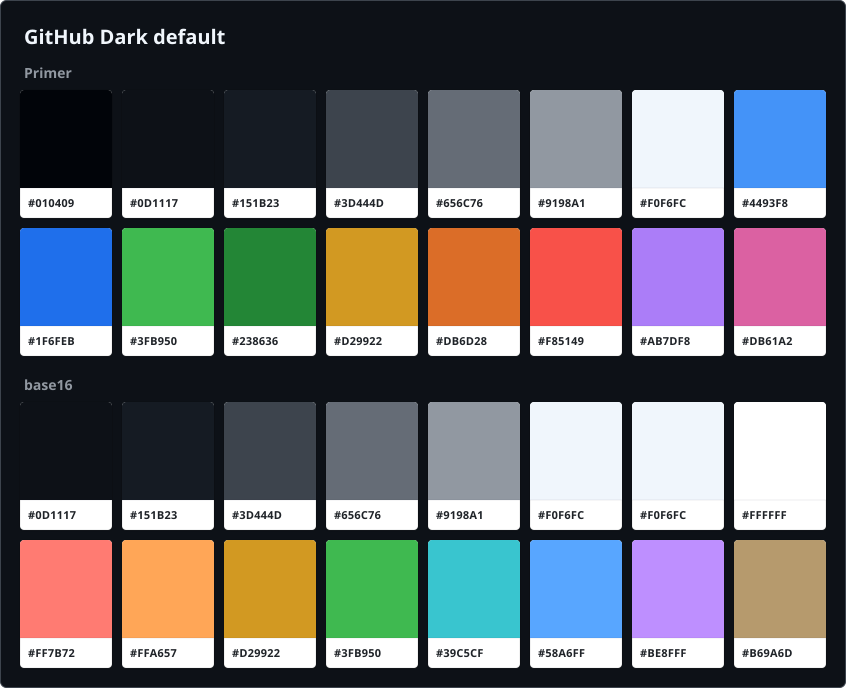
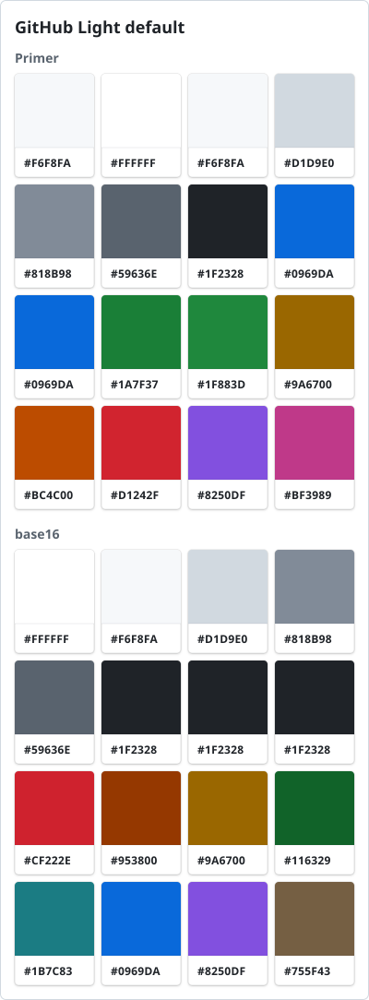

# github-primer-theme

GitHub's "Dark default" and "Light default" themes and Octicons, taken from
GitHub's [Primer](https://primer.style) packages, for theming other apps.




| File | Contents |
| --- | --- |
| `tokens.json` | All 959 tokens per theme, resolved to plain values |
| `dark.css`, `light.css` | The tokens as CSS variables on `:root` |
| `theme.css` | Both themes, following the system setting |
| `base16/` | base16 schemes for 16-colour apps |
| `icons/` | All Octicons as SVG (`<name>-<size>.svg`) |
| `preview/` | The palette images above |
| `build.py` | Regenerates the files above |

Source: `@primer/primitives` 11.10.0 and `@primer/octicons` 19.42.0.

## CSS

```html
<link rel="stylesheet" href="theme.css">
```

```css
body { background: var(--bgColor-default); color: var(--fgColor-default); }
```

`theme.css` is light by default and dark when the system prefers dark. Add
`data-theme="light"` or `data-theme="dark"` to any element to pin it.

Other apps can read `tokens.json`: `{"source": …, "dark": {…}, "light": {…}}`.

## base16

Works with Stylix and base16 templates:

```nix
stylix.base16Scheme = "${github-primer-theme}/base16/github-dark-default.yaml";
```

Each slot comes from a Primer token, named in a comment beside it. Two
compromises:

- Comments use `base03`, which is dimmer than GitHub's comment colour.
- `base06` repeats `base05` (and `base07` too in light), because Primer has no
  colour in between.

To change a slot, edit `BASE16` in `build.py` and rebuild.

## Icons

The SVGs have no fill. Inline them and set one, such as `fill: currentColor`.

## Rebuild

```sh
python3 build.py
python3 build.py --primitives X.Y.Z --octicons X.Y.Z
```

Needs only Python 3.11+. It verifies each package's sha512 and replaces all
generated files.

## License

MIT. The tokens and icons are GitHub's, also MIT: see
`LICENSE-primer-primitives` and `LICENSE-primer-octicons`. The banner is
GitHub's [Universe 2022](https://github.blog/) artwork, linked rather than
included, and is not covered by this licence.
